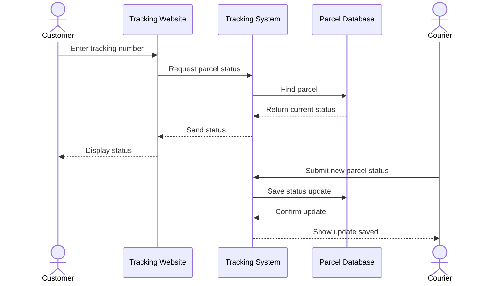

# Courier and Parcel Tracking Lab

## Sequence diagram



## Run the tests

Install pytest and run the unit tests:

```bash
python -m pip install pytest
python -m pytest
```

The GitHub Actions workflow runs pytest automatically whenever code is pushed or a pull request is opened.
